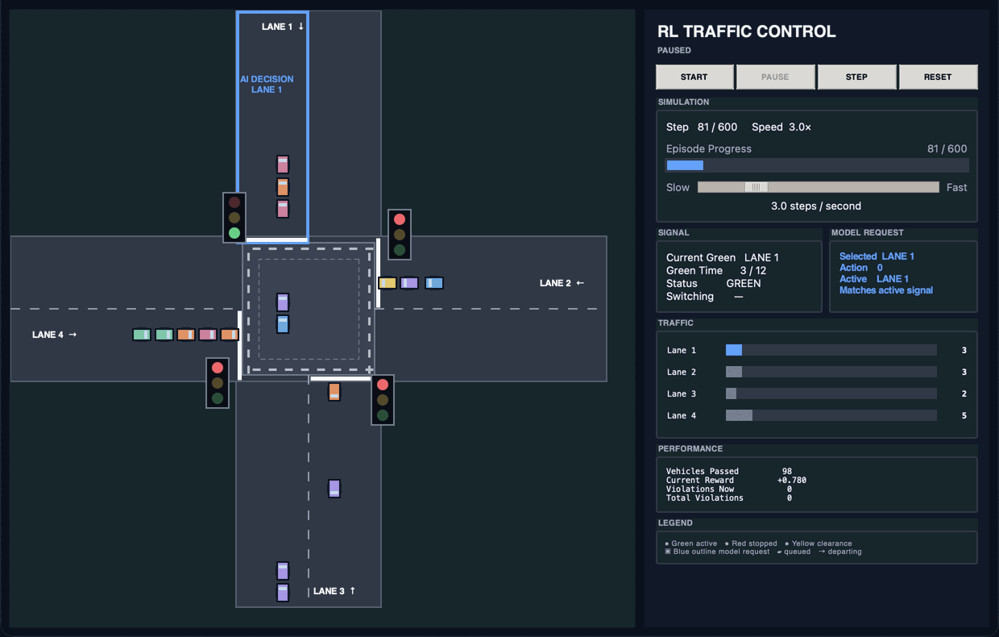
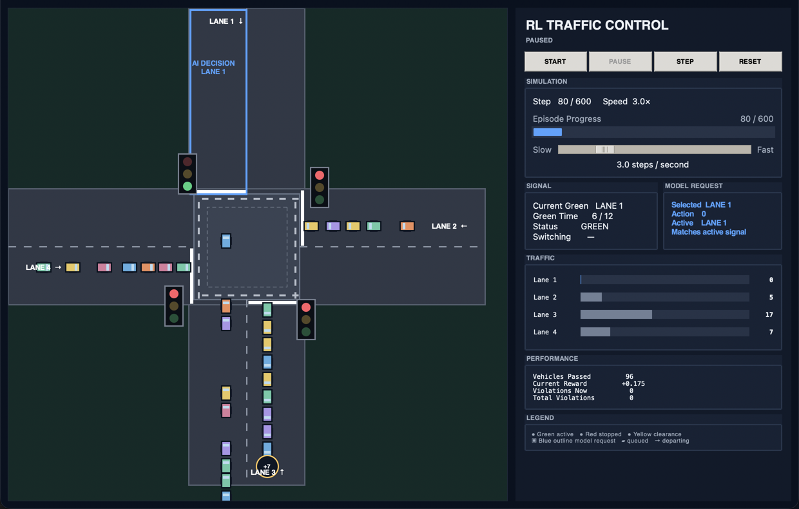
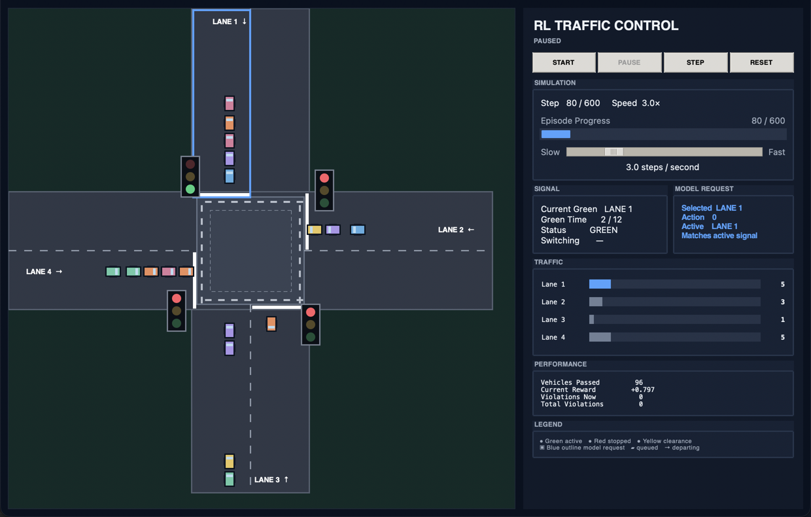
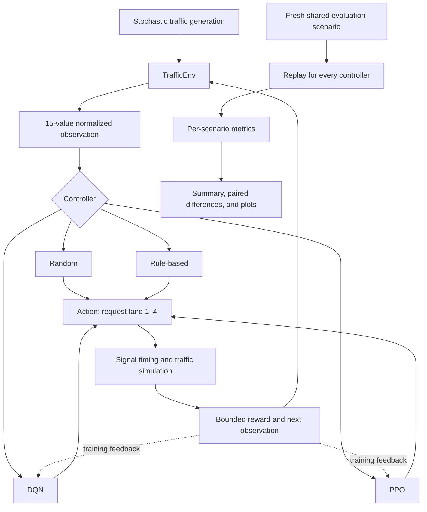
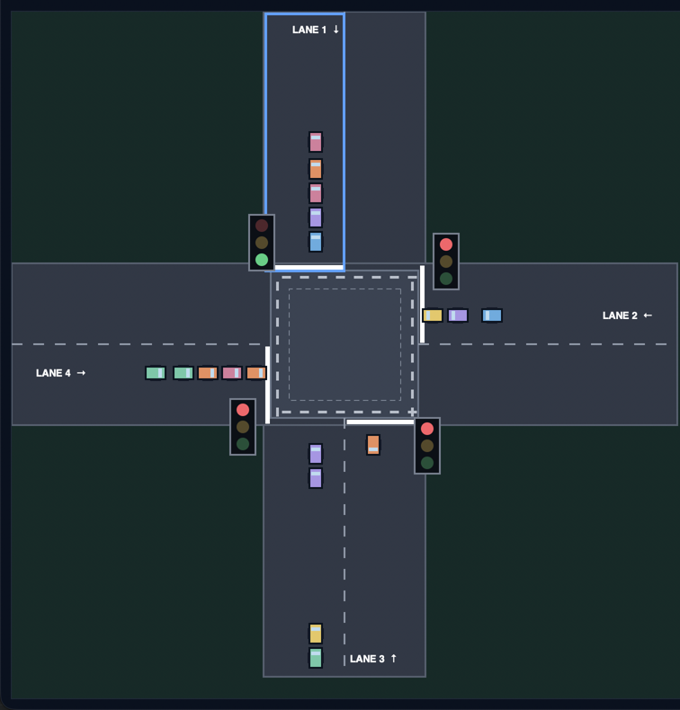
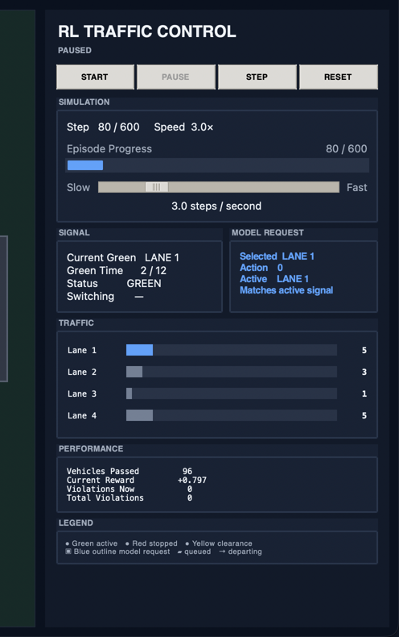

# Intelligent Traffic Signal Control using Reinforcement Learning

A compact research project that compares DQN, PPO, and two non-learning baselines on
a stochastic four-lane intersection. It includes a custom Gymnasium environment,
bounded reward shaping, paired randomized evaluation, saved models, automated tests,
and a Tkinter simulator.



## Overview

Fixed traffic schedules can allocate green time poorly when demand changes. This
project frames signal selection as a reinforcement-learning problem: once per
simulation step, a controller requests one of four incoming lanes, observes normalized
queue and waiting information, and receives a bounded reward that balances throughput
against congestion, delay, starvation, and unnecessary switching.

The simulator is intentionally small enough to inspect end to end. It models one
intersection rather than claiming to reproduce real road networks.

## Key Features

- Stochastic Bernoulli traffic arrivals on four independent lanes
- Custom Gymnasium environment with a 15-value normalized observation
- Stable-Baselines3 DQN and PPO controllers
- Random and transparent rule-based baselines
- Bounded, component-wise reward with diagnostics in `info`
- Randomized paired evaluation on shared arrival scenarios
- Raw 500-scenario results with per-episode records
- Tkinter animation for queues, signals, actions, and departures
- Automated environment, reward, training, evaluation, plotting, and GUI tests

## Demo

| DQN | PPO |
|---|---|
|  |  |

The simulator uses the numerical environment as its source of truth. The left side
animates queues, signal state, model lane requests, and individual departures; the
right side reports episode progress, active/pending lanes, queue lengths, reward,
throughput, and violations.

```bash
# DQN
python -m traffic_sim.visualizer \
  --algorithm dqn \
  --model-path models/dqn_traffic_randomized

# PPO
python -m traffic_sim.visualizer \
  --algorithm ppo \
  --model-path models/ppo_traffic_randomized
```

## System Architecture



## Reinforcement Learning Formulation

### State / Observation Space

`TrafficEnv` exposes a `Box(0, 1, shape=(15,))` observation in this order:

| Indices | Values | Calculation |
|---|---|---|
| 0–3 | Queue utilization for lanes 1–4 | queue length / hard limit (40) |
| 4–7 | Mean waiting for lanes 1–4 | clipped lane mean wait / 30 |
| 8–11 | Current green lane | four-value one-hot vector |
| 12 | Green duration | clipped current green time / 12 |
| 13 | Switching flag | 1 during clearance, otherwise 0 |
| 14 | Pending lane | pending zero-based lane / 3; zero when absent |

The switching flag disambiguates “no pending lane” from a pending request for lane 1.

### Action Space

The action space is `Discrete(4)`:

| Action | Requested green lane |
|---:|---|
| 0 | Lane 1 |
| 1 | Lane 2 |
| 2 | Lane 3 |
| 3 | Lane 4 |

A request does not bypass timing constraints. Before the three-step minimum green,
another-lane request is deferred. A valid change starts one clearance step with no
discharge. Holding a lane through 12 green steps forces rotation to the next lane.
Exactly one lane remains the active green lane in the environment state.

### Reward Function

For lane $i$, let $Q_i$ be queue length, $H_i=40$ the hard limit,
$L_i=20$ the soft limit, and $\bar W_i$ the mean waiting time of queued vehicles.
The implementation computes:

$$
q = \frac{1}{4}\sum_i \frac{Q_i}{H_i}, \qquad
w = \frac{1}{4}\sum_i \operatorname{clip}\left(\frac{\bar W_i}{30},0,1\right)
$$

$$
o = \frac{1}{4}\sum_i
\left(\frac{\max(Q_i-L_i,0)}{H_i-L_i}\right)^2,
\qquad
s = \frac{1}{4}\sum_i
\operatorname{clip}\left(\frac{\max(\bar W_i-15,0)}{15},0,1\right)
$$

If $P_t$ vehicles pass during a step, throughput is $T_t=P_t/2$. Queue
progress is $\Delta q_t=q_{t-1}-q_t$, and $I_t=1$ only when a switch is
initiated. The reward is:

$$
r_t = 1.0T_t - 0.5q_t - 0.5w_t - 1.0o_t - 0.5s_t
      + 0.3\Delta q_t - 0.02I_t
$$

All pressures and throughput are normalized to finite ranges, overflow is quadratic
only above the soft limit, and waiting/starvation ratios are clipped. This prevents
unbounded queue or waiting magnitudes from dominating optimization. The redesign was
important for stable learning in this project, but it is engineered for this simulator
and is not claimed to be globally optimal.

### Episode Dynamics

- Each of the four lanes independently attempts one arrival with probability `0.35`
  per simulation step.
- A lane holds at most 40 vehicles; arrivals to a full lane are dropped.
- Queued vehicles accrue one vehicle-step of waiting before discharge.
- The active lane serves at most two vehicles per step.
- Minimum green is 3 steps, maximum green is 12 steps, and clearance is 1 step.
- An episode truncates after 600 simulation steps.
- One step is the model's discrete simulation interval; the implementation does not
  calibrate it to a measured real-world second.

The reported waiting metric preserves the evaluator's established definition: for
each episode it averages the aggregate waiting state of vehicles still queued at each
step. It is not an estimate of real-world seconds.

## Algorithms

### DQN

DQN learns an action-value function for the four discrete lane requests. The project
uses a 64×64 MLP, replay buffer, epsilon-greedy exploration, and a periodically updated
target network.

| Setting | Value |
|---|---:|
| Training budget | 100,000 steps |
| Learning rate | 0.0001 |
| Replay buffer | 50,000 |
| Learning starts | 1,000 |
| Batch size | 64 |
| Discount factor | 0.99 |
| Train frequency | every 4 steps |
| Gradient steps | 1 |
| Target update interval | 1,000 |
| Exploration fraction | 0.4 |
| Final epsilon | 0.05 |

### PPO

PPO is an on-policy actor-critic method. It collects rollouts, estimates advantages,
and applies multiple epochs of clipped policy updates so that each update remains near
the behavior that generated the rollout. This project uses separate 64×64 policy and
value networks on CPU.

| Setting | Value |
|---|---:|
| Requested training budget | 100,000 steps |
| Learning rate | 0.0003 |
| Rollout length | 2,048 |
| Batch size | 64 |
| Epochs per rollout | 10 |
| Discount factor | 0.99 |
| GAE lambda | 0.95 |
| Clip range | 0.2 |
| Entropy coefficient | 0.01 |

Stable-Baselines3 completes whole PPO rollouts, so the saved model records 100,352
timesteps for the requested 100,000-step run.

## Baselines

- **Random:** samples each of the four requests uniformly with an independent random
  generator.
- **Rule-based:** selects the largest score
  `queue_utilization + 0.7 × normalized_mean_waiting`. Timing constraints still apply.

## Experimental Methodology

The final report uses 500 independently generated traffic scenarios and deterministic
predictions from the trained DQN and PPO models. There is no user-facing fixed seed.

For scenario $k$, the evaluator first generates all 600×4 attempted arrivals. It
then replays that exact exogenous sequence for Random, Rule-based, DQN, and PPO before
generating scenario $k+1$. Accepted arrivals can later differ when a controller fills
a lane to its hard limit; the attempted demand remains identical. This paired design
controls scenario difficulty more directly than evaluating controllers on unrelated
random traffic.

Reported standard deviations are sample SDs across episodes. A 95% confidence interval
for a mean is computed as $\bar x \pm 1.96s/\sqrt{500}$. Medians summarize the
episode distribution separately and are not confidence-interval centers. These random
simulation results provide evidence over the sampled scenarios; they do not by
themselves prove generalization to real traffic.

## Results

Results below come from [`results/evaluation_500.json`](results/evaluation_500.json).
Values after `±` are sample standard deviations across 500 scenarios.

| Controller | Reward | Waiting metric | Mean max queue | Vehicles passed | Mean violations |
|---|---:|---:|---:|---:|---:|
| Random | -307.82 ± 57.06 | 4,645.35 ± 878.71 | 39.97 | 705.04 ± 14.48 | 962.87 |
| Rule-based | -290.80 ± 85.53 | 3,767.59 ± 1,242.27 | 35.17 | 713.06 ± 4.74 | 873.63 |
| DQN | 239.38 ± 8.85 | 305.13 ± 39.68 | 21.26 | 816.78 ± 21.52 | 5.12 |
| PPO | 299.94 ± 5.01 | 168.41 ± 25.46 | 15.08 | 822.37 ± 21.45 | 0.04 |

| Controller | Episodes with any soft-limit violation | Soft-limit episode rate | Hard-limit episode rate |
|---|---:|---:|---:|
| Random | 500 / 500 | 100.0% | 99.2% |
| Rule-based | 500 / 500 | 100.0% | 25.4% |
| DQN | 289 / 500 | 57.8% | 0.0% |
| PPO | 4 / 500 | 0.8% | 0.0% |

Within these 500 simulated scenarios, PPO had higher observed mean reward and
throughput, lower observed waiting, shorter maximum queues, and fewer violations than
DQN. This is a multi-metric empirical comparison, not a claim of optimality or
deployment readiness.

## Statistical Comparison

Paired values are calculated scenario by scenario as `PPO − DQN`:

| Metric | Mean difference | SD | 95% CI for mean difference |
|---|---:|---:|---:|
| Reward | +60.56 | 9.10 | [59.76, 61.36] |
| Waiting metric | -136.72 | 22.07 | [-138.66, -134.79] |
| Vehicles passed | +5.58 | 2.88 | [5.33, 5.84] |
| Violations | -5.07 | 7.23 | [-5.71, -4.44] |

The intervals quantify uncertainty in the estimated mean paired differences for these
randomized scenarios. The project does not perform or claim an additional formal
significance test.

## Visualization

The GUI loads either Stable-Baselines3 model type and always calls
`predict(..., deterministic=True)`. Every reported departure gets a distinct animated
vehicle, while the numerical environment remains authoritative.

| Traffic and signals | Metrics panel |
|---|---|
|  |  |

Documentation media can be recaptured from the actual app on macOS with:

```bash
python -m scripts.capture_demo \
  --algorithm ppo \
  --model-path models/ppo_traffic_randomized \
  --screenshot docs/assets/ppo-simulator.png \
  --gif docs/assets/traffic-simulator-demo.gif
```

## Project Structure

```text
traffic_sim/
├── traffic_sim/            # Environment, controllers, training, evaluation, GUI
├── models/                 # Saved randomized DQN and PPO demonstration models
├── results/                # Raw 500-scenario evaluation JSON
├── scripts/                # Plotting and simulator-capture helpers
├── docs/
│   ├── technical.md        # Internal design reference
│   └── assets/             # Simulator media and generated result figures
├── tests/                  # Unit, smoke, evaluation, plotting, and GUI tests
├── requirements.txt
├── pytest.ini
└── README.md
```

Important modules:

- `environment.py`: Gymnasium lifecycle, signal logic, observation, and reward
- `traffic.py`: aggregate queues, waiting accumulation, arrivals, and discharge
- `scenarios.py`: immutable attempted-arrival scenarios for paired replay
- `controllers.py`: Random and rule-based baselines
- `train.py`: fresh DQN/PPO training and PPO resume support
- `evaluate.py`: shared-scenario evaluation and raw JSON output
- `utils.py`: per-episode metrics, summaries, confidence intervals, paired differences
- `visualizer.py`: model-driven Tkinter simulator

See [docs/technical.md](docs/technical.md) for implementation details.

## Installation

Python 3.10 or later is recommended.

```bash
python3 -m venv .venv
source .venv/bin/activate
python -m pip install --upgrade pip
python -m pip install -r requirements.txt
```

## Usage

### Train DQN

```bash
python -m traffic_sim.train \
  --algorithm dqn \
  --timesteps 100000 \
  --model-path models/dqn_traffic_randomized
```

### Train PPO

```bash
python -m traffic_sim.train \
  --algorithm ppo \
  --timesteps 100000 \
  --model-path models/ppo_traffic_randomized
```

PPO can continue for additional timesteps with `--resume-from`; DQN training always
starts fresh.

### Evaluate

```bash
python -m traffic_sim.evaluate \
  --model-path models/dqn_traffic_randomized \
  --ppo-model-path models/ppo_traffic_randomized \
  --episodes 500 \
  --output results/evaluation_500.json
```

### Plot Results

```bash
python -m scripts.plot_results \
  --input results/evaluation_500.json \
  --output-dir docs/assets/results
```

### Run DQN Visualization

```bash
python -m traffic_sim.visualizer \
  --algorithm dqn \
  --model-path models/dqn_traffic_randomized
```

### Run PPO Visualization

```bash
python -m traffic_sim.visualizer \
  --algorithm ppo \
  --model-path models/ppo_traffic_randomized
```

## Testing

```bash
pytest -q
```

Tests include short temporary DQN/PPO smoke runs; they do not retrain the saved
100,000-step models. The current validated suite contains 35 tests.

## Reproducibility

Normal training, visualization, and evaluation are intentionally nondeterministic and
do not expose a fixed seed. Gymnasium keeps one entropy-backed generator per environment
and advances it across resets. Evaluation creates a new arrival matrix for each episode
and shares that matrix across controllers.

[`results/evaluation_500.json`](results/evaluation_500.json) stores all 500 attempted-
arrival matrices, 2,000 per-controller episode rows, summaries, and paired differences.
Those matrices can be reconstructed as `TrafficScenario` objects for internal replay.
The saved DQN/PPO archives and the training configurations in `logs/` record the models
used, while evaluation remains randomized rather than guaranteeing byte-for-byte
identical results on a new run.

## Limitations

- One simplified isolated intersection, not a road network
- Aggregate queues rather than car-following, turning, pedestrian, or collision models
- Simulated demand with a fixed 0.35 arrival probability per lane
- Four lane-selection actions and one green lane at a time
- No calibration to real traffic detectors or physical seconds
- Reward weights and hyperparameters are project-specific rather than globally optimal
- Results are simulation-based and do not establish deployment readiness

## Future Work

- Multiple connected intersections and multi-agent control
- Time-varying or measured traffic-demand profiles
- Turning movements, pedestrians, and richer vehicle dynamics
- Systematic hyperparameter and reward sensitivity studies
- Additional RL and operations-research baselines
- Real traffic datasets and simulation-to-reality validation
- Real-time controller integration with safety constraints

## License

This project is available under the [MIT License](LICENSE).
